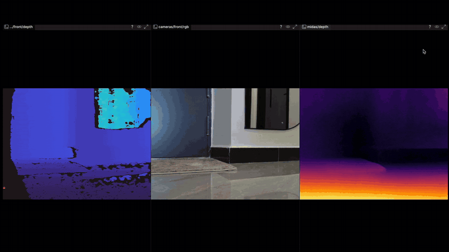
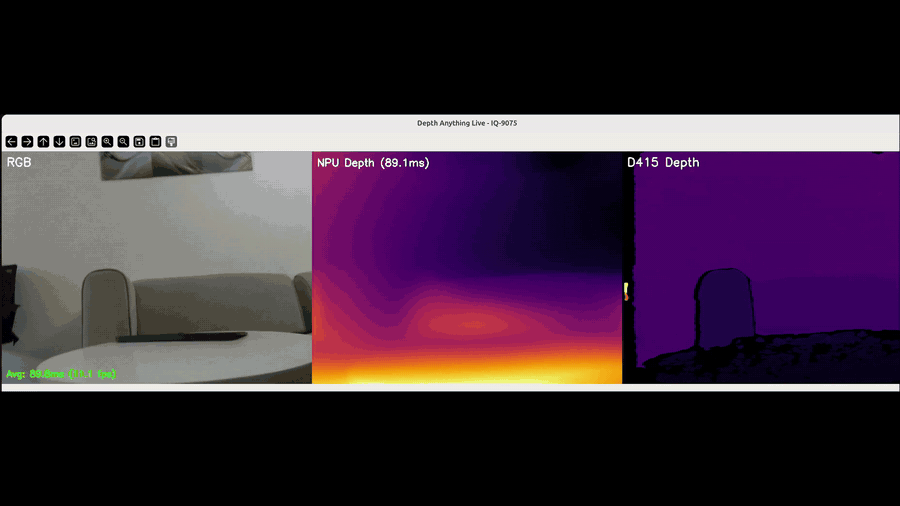

# Dragonwing Depth Estimation

Real-time monocular depth estimation on two Qualcomm Dragonwing platforms, each
running a different model on its Hexagon NPU alongside an Intel RealSense D415
for a side-by-side comparison of learned depth versus hardware depth.

- **IQ-9075 EVK (QCS9075)** runs **Depth Anything** (float TFLite) on the NPU.
- **Rubik Pi 3 (QCS6490)** runs **MiDaS V2** (w8a8 quantized TFLite) on the NPU.

Both scripts display three panels side by side: RGB, the model's depth output,
and the D415 hardware depth. Both run fully on-device with no cloud dependency,
and both can stream to a Rerun viewer with `--rerun`.

## Demo

**Rubik Pi 3, MiDaS V2 on the QCS6490 NPU**



**IQ-9075, Depth Anything on the QCS9075 NPU**



## Benchmarks

| Platform | Model | Input | Runtime | Inference | FPS |
| --- | --- | --- | --- | --- | --- |
| IQ-9075 EVK (QCS9075) | Depth Anything (float) | 518x518 | TFLite + QNN NPU | ~90.5 ms | ~11 |
| Rubik Pi 3 (QCS6490) | MiDaS V2 (w8a8) | 256x256 | TFLite + QNN NPU | ~117 ms | ~8.5 |

Numbers are average inference time from the live runs (the on-screen `Avg` line),
measured over the `interpreter.invoke()` call after warmup.

## Repository layout

```
dragonwing-depth-estimation/
  iq9075/
    depth_anything_live.py     # IQ-9075 Depth Anything live script
    requirements.txt
  rubikpi3/
    midas_live_rubikpi.py      # Rubik Pi 3 MiDaS live script
    requirements.txt
  models/                      # weights go here (not committed, see models/README.md)
    depth_anything/
    midas/
  media/                       # demo GIFs
  LICENSE
  README.md
```

## Setup

Clone the repo on each board, then download the matching model from
[Qualcomm AI Hub](https://aihub.qualcomm.com/) into `models/` as described in
[`models/README.md`](models/README.md).

### IQ-9075 EVK

```bash
cd iq9075
pip install -r requirements.txt
```

### Rubik Pi 3

```bash
cd rubikpi3
pip install -r requirements.txt
```

The QNN TFLite delegate is expected at `/usr/lib/libQnnTFLiteDelegate.so`, which
ships with the Qualcomm software stack on both boards.

## Run

IQ-9075:

```bash
cd iq9075
python3 depth_anything_live.py              # NPU (default)
python3 depth_anything_live.py --cpu        # CPU, skips the QNN delegate
python3 depth_anything_live.py --rerun      # stream to a Rerun viewer
python3 depth_anything_live.py --model /path/to/depth_anything.tflite
```

Rubik Pi 3:

```bash
cd rubikpi3
python3 midas_live_rubikpi.py               # NPU (default)
python3 midas_live_rubikpi.py --cpu         # CPU, skips the QNN delegate
python3 midas_live_rubikpi.py --rerun       # stream to a Rerun viewer
```

Press `q` to quit. On exit, each script prints the frame count and average
inference time.

## Confirm the NPU is actually being used

It is easy to think you are running on the NPU while the model has quietly
fallen back to CPU. Two quick checks:

1. **Watch the startup log.** When the delegate loads you will see
   `[NPU] QNN delegate loaded from /usr/lib/libQnnTFLiteDelegate.so`. If you see
   `Failed to load QNN delegate` followed by `Falling back to CPU`, it is on CPU.
2. **Compare against `--cpu`.** Run once normally and once with `--cpu` and
   compare the on-screen `Avg` time. If the NPU is engaging, the default run is
   several times faster than the `--cpu` run. If the two are about the same, the
   delegate is not actually taking the model.

On the Rubik Pi 3, note that the QCS6490 NPU does not support FP16, so a float
MiDaS graph fails op validation and silently drops to CPU. Use the w8a8
quantized model so the graph stays on-chip.

## License

MIT, see [LICENSE](LICENSE).
